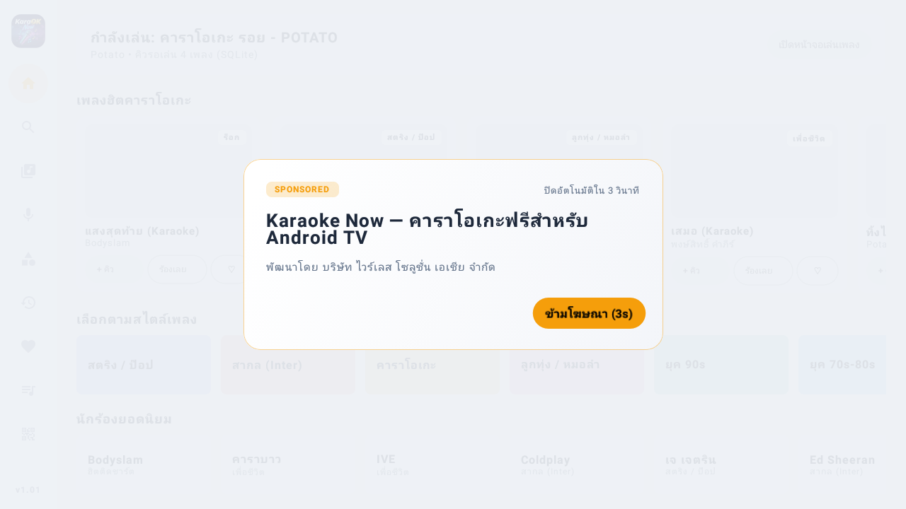
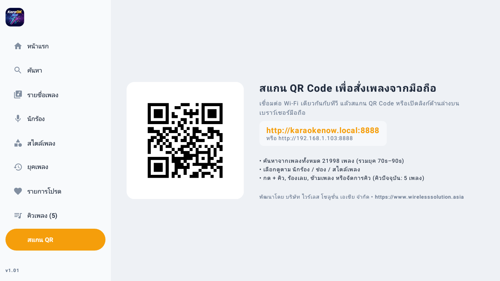
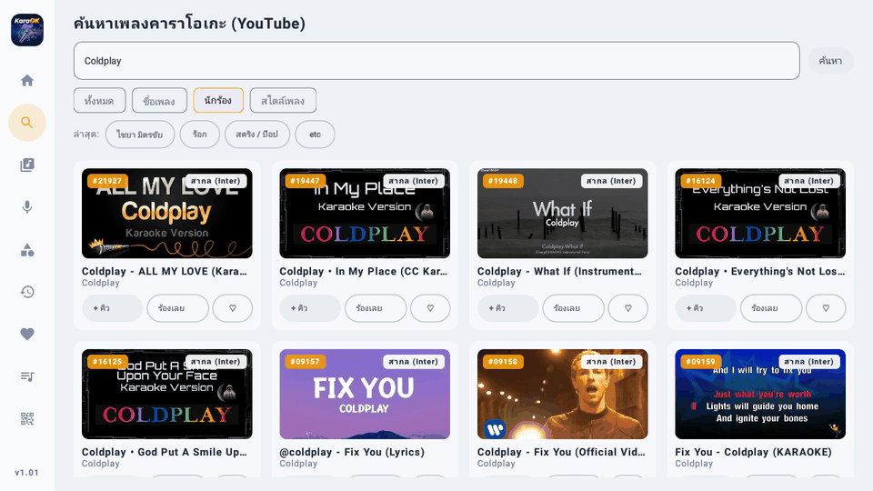
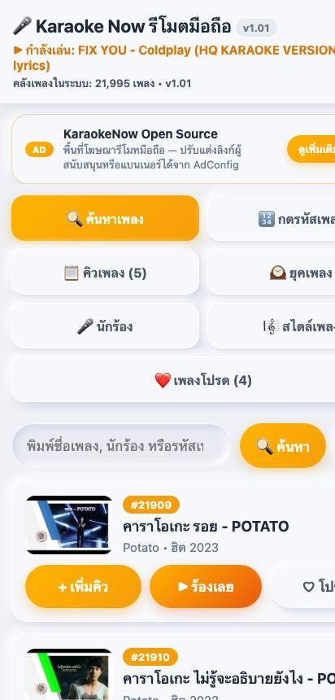

# 🎤 Karaoke Now (v1.01)

แอปคาราโอเกะสำหรับ **Android TV** พร้อม **รีโมทมือถือผ่านเว็บเบราว์เซอร์** (`http://karaokenow.local:8888` หรือสแกน QR Code) รวบรวมคลังเพลงคาราโอเกะจาก YouTube กว่า **21,995 เพลง** และศิลปินกว่า **2,348 รายชื่อ**

> **📜 สัญญาอนุญาต (Open Source — Non-Commercial Use Only)**  
> โปรเจกต์นี้เปิดเป็น **Open Source** ให้บุคคลทั่วไปสามารถดาวน์โหลดโค้ดและไฟล์ APK ไปใช้งาน ศึกษา และปรับแต่งได้ฟรี **เฉพาะการใช้งานส่วนตัวและไม่แสวงหาผลกำไรเท่านั้น**  
> ❌ **ห้ามนำไปใช้ในเชิงพาณิชย์ กิจการที่มีรายได้ เก็บค่าบริการ หรือแสวงหาผลประโยชน์ทางการค้าทุกกรณี** (รายละเอียดเพิ่มเติมในไฟล์ [`LICENSE`](LICENSE))
>
> **📢 สิทธิ์ในการโฆษณาสำหรับผู้พัฒนา (Developer Advertising Rights)**  
> - สิทธิ์ในการกำหนด แสดงผล จัดการแคมเปญโฆษณา และรับรายได้จากพื้นที่โฆษณา/ผู้สนับสนุนภายในแอปพลิเคชัน (ทั้งหน้าโฆษณาเปิดแอป `AppOpenAdOverlay` และแบนเนอร์บนหน้ารีโมทมือถือ `/api/ad-config` ผ่าน `AdConfig`) **เป็นสิทธิ์ขาดของผู้พัฒนาเจ้าของโปรเจกต์ (`sensorthai / Karaoke Now`) แต่เพียงผู้เดียว**  
> - ห้ามบุคคลภายนอกนำซอร์สโค้ดหรือไฟล์ APK ไปดัดแปลง ลบ/แทนที่โฆษณาของผู้พัฒนา หรือแทรกโฆษณาเพื่อหาผลประโยชน์ทางการค้าโดยไม่ได้รับอนุญาตเป็นลายลักษณ์อักษรจากผู้พัฒนา

> **⚖️ ข้อชี้แจงเรื่องลิขสิทธิ์และข้อกำหนดการใช้งาน YouTube (YouTube Copyright & ToS Notice)**  
> - แอปนี้ทำงานเป็น **ตัวเล่นและจัดคิวลิงก์สาธารณะ (Player / Indexer)** โดยเล่นวิดีโอสตรีมจาก YouTube โดยตรง ไม่ได้ดาวน์โหลด จัดเก็บ ทำซ้ำ หรือแจกจ่ายไฟล์วิดีโอ/เสียงละเมิดลิขสิทธิ์ไว้ในตัวแอปหรือเซิร์ฟเวอร์ส่วนตัว  
> - ลิขสิทธิ์ของเพลง มิวสิควิดีโอ และภาพปกทั้งหมดยังคงเป็นของ **เจ้าของลิขสิทธิ์และครีเอเตอร์ต้นฉบับบน YouTube**  
> - ผู้ใช้งานและผู้ที่นำโค้ดไปต่อยอดควรใช้งานร่วมกับ **YouTube Data API / Official Player** และปฏิบัติตาม [ข้อกำหนดการให้บริการของ YouTube (YouTube Terms of Service)](https://www.youtube.com/t/terms) รวมถึงไม่บล็อกโฆษณาของเจ้าของช่องและไม่นำไปใช้เพื่อแสวงหาผลประโยชน์ทางการค้า

---

## 📖 คู่มือการใช้งานทีละขั้นตอน (เข้าใจง่าย สำหรับผู้สูงอายุและทุกคนในบ้าน)

### ขั้นตอนที่ 1: เปิดแอป Karaoke Now บนทีวี
- เปิดเครื่อง Android TV แล้วกดเข้าแอป **Karaoke Now** (หรือกดปุ่ม **Home** บนรีโมทหากตั้งค่า Kiosk Mode ไว้)
- เมื่อเปิดขึ้นมาจะพบหน้าหลักพร้อมรายการเพลงฮิตและแถบเมนูด้านซ้าย



### ขั้นตอนที่ 2: กดปุ่มซ้าย-ลงบนรีโมททีวี มาที่เมนู "สแกน QR"
- กดปุ่ม **ลูกศรซ้าย (◀)** ที่รีโมททีวีเพื่อเปิดแถบเมนูด้านซ้าย แล้วกด **ลูกศรลง (▼)** เลื่อนลงมาที่เมนู **สแกน QR** ด้านล่างสุด จากนั้นกดปุ่ม **ตกลง (OK / Enter)**
- หน้าจอทีวีจะแสดง **QR Code** ขนาดใหญ่ พร้อมลิงก์ `http://karaokenow.local:8888`



### ขั้นตอนที่ 3: เอามือถือสแกน QR Code เพื่อเปิดรีโมทเลือกเพลง
- เชื่อมต่อมือถือกับ **Wi-Fi วงเดียวกันกับทีวี**
- เปิดกล้องมือถือ (หรือแอป LINE / สแกน QR) ส่องไปที่ QR Code บนหน้าจอทีวี แล้วแตะลิงก์ที่ขึ้นมา
- หน้าเว็บ **Karaoke Now รีโมทมือถือ** จะเปิดขึ้นทันที พิมพ์ค้นหาชื่อเพลง ชื่อนักร้อง หรือกดรหัสเพลง 5 หลัก แล้วกด **`+ คิว`** หรือ **`▶ ร้องเลย`** ได้เลย (กด **`❤️ โปรด`** เพื่อเก็บเพลงโปรดไว้ร้องวันหลังได้ด้วย)


### ขั้นตอนที่ 4: เพลงที่กดจากมือถือจะเข้าคิวบนทีวีทันที
- เพลงที่กดสั่งจากมือถือจะไปปรากฏในเมนู **คิวเพลง** บน Android TV และเล่นต่อเนื่องให้อัตโนมัติ


---

## 🎬 ตัวอย่างการใช้งาน (Demo)

| หน้าจอ Android TV (`Karaoke Now`) | รีโมทมือถือผ่านเว็บ (`karaokenow.local:8888`) |
| :---: | :---: |
|  |  |

---

## 📺 สเปคขั้นต่ำและสเปคแนะนำของ Android TV

| รายการ | สเปคขั้นต่ำ (Minimum) | สเปคแนะนำ (Recommended) |
| :--- | :--- | :--- |
| **ระบบปฏิบัติการ** | Android 5.0 (API 21) ขึ้นไป | Android TV 7.1.2 / 9+ หรือ Google TV |
| **หน่วยประมวลผล (CPU)** | Quad-Core ARM Cortex-A53 1.2 GHz | Quad-Core 1.5 GHz+ (รองรับ Hardware Decode H.264 / VP9) |
| **หน่วยความจำ (RAM)** | 1 GB | 2 GB ขึ้นไป (ค้นหาคลังเพลง 21,995+ เพลงและเล่น 1080p ลื่นไหล) |
| **พื้นที่เก็บข้อมูล** | ว่างอย่างน้อย 200 MB | ว่าง 500 MB ขึ้นไป (สำหรับ SQLite, แคชปก และไฟล์สำรองโปรด) |
| **เครือข่าย (Network)** | Wi-Fi 2.4GHz หรือ LAN | Wi-Fi 5GHz หรือ LAN (วงเดียวกับมือถือ, รองรับ mDNS `.local`) |
| **การควบคุม** | รีโมท TV (D-Pad) | รีโมท TV + มือถือสแกน QR ผ่านเว็บเบราว์เซอร์ |

---

## ✨ ความสามารถและฟังก์ชันหน้าจอ

### 1. หน้าจอหลักบน Android TV (9 เมนูหลัก)
- **หน้าแรก (Home):** แสดงเพลงที่กำลังเล่นอยู่, สถานะคิวรอเล่น, เพลงฮิตคาราโอเกะ, ศิลปินแนะนำ และสไตล์เพลงยอดนิยม
- **ค้นหา (Search):** ค้นหาจากชื่อเพลง, นักร้อง, สไตล์เพลง หรือรหัสเพลง 5 หลัก พร้อมตัวกรองหมวดหมู่และประวัติการค้นหาล่าสุด
- **รายชื่อเพลง (Catalog):** เรียกดูคลังเพลงทั้งหมดในระบบจากฐานข้อมูล SQLite (`song_cache`)
- **นักร้อง (Artists):** เลือกดูเพลงแยกตามศิลปิน พร้อมกดปุ่ม ❤️ บันทึกเป็นนักร้องโปรด
- **สไตล์เพลง (Styles):** แยกหมวดหมู่เพลง เช่น สตริง / ป๊อป, ลูกทุ่ง / หมอลำ, ร็อก, เพื่อชีวิต, ลูกกรุง, สากล (Inter) ฯลฯ
- **ยุคเพลง (Eras):** แยกตามยุคสมัย 5 ยุค ตั้งแต่ยุคบุกเบิก/ลูกกรุง จนถึงยุค 2000s–ปัจจุบัน
- **รายการโปรด (Favorites):** รวมเพลงโปรดและศิลปินโปรดทั้งหมด (สำรองข้อมูลอัตโนมัติลง `/sdcard/Documents/KaraokeNow/favorites_backup.json` ข้อมูลไม่หายแม้ลงแอปใหม่)
- **คิวเพลง (Queue):** จัดการคิวเพลงรอเล่น, กดเล่นทันที, ข้ามเพลง, ล้างคิว และกด ❤️ เพิ่มเป็นเพลงโปรดได้จากหน้าคิวเพลงโดยตรง
- **สแกน QR (QR Remote):** แสดง QR Code และ URL (`http://<TV-IP>:8888` และ `http://karaokenow.local:8888`) สำหรับใช้มือถือสแกนเปิดรีโมททันที
- **หน้าโฆษณา / ผู้สนับสนุนตอนเปิดแอป:** แสดงแบนเนอร์ผู้สนับสนุน 5 วินาที (กดปุ่มข้ามได้ด้วยรีโมท) รองรับอัปเดตแคมเปญจาก Remote JSON

### 2. รีโมทมือถือผ่านเว็บเบราว์เซอร์ (Web App)
เปิดบนมือถือ/แท็บเล็ตในวง Wi-Fi เดียวกันผ่าน `http://karaokenow.local:8888` หรือ IP ของทีวี (เช่น `http://192.168.1.103:8888`):
- **🔍 ค้นหาเพลง:** ค้นหาชื่อเพลง, นักร้อง, รหัสเพลง พร้อมกด `+ คิว`, `▶ ร้องเลย` หรือ `❤️ โปรด`
- **🔢 กดรหัสเพลง:** แป้นพิมพ์ตัวเลขสำหรับกดรหัสเพลง 5 หลักแบบตู้คาราโอเกะ
- **📋 คิวเพลง:** ดูเพลงที่กำลังเล่น, เลื่อนคิว, ลบคิว, ข้ามเพลง และกดเพิ่มเพลงโปรดจากในคิว
- **🕰️ ยุคเพลง / 🎼 สไตล์เพลง:** เลือกดูเพลงตามยุคและแนวเพลง
- **🎤 นักร้อง:** มีช่องค้นหา/กรองชื่อนักร้องแบบทันที และตัวกรองเฉพาะ `★ นักร้องโปรด`
- **❤️ เพลงโปรด:** ดูและจัดการเพลงโปรดทั้งหมด

### 3. ระบบเบื้องหลัง, mDNS, Kiosk Mode และการจัดการโฆษณา
- **เปิดเครื่องพร้อมใช้งานทันที:** มี `BootReceiver` และ `KaraokeServerService` (Foreground Service) เริ่ม Web Server และ mDNS (`karaokenow.local:8888`) อัตโนมัติทุกครั้งที่เปิด Android TV
- **Kiosk Mode (กดปุ่ม Home แล้วกลับมาที่แอปทันที):** รองรับการตั้งเป็น Home Launcher (`CATEGORY_HOME`) เมื่อกดปุ่ม **Home** บนรีโมท Android TV สามารถเลือก **Karaoke Now → เสมอ (Always)** เพื่อใช้งานแบบตู้คาราโอเกะเต็มรูปแบบ (หรือตั้งผ่าน ADB: `adb shell cmd package set-home-activity com.karaoketv.app/.MainActivity`)
- **จัดการโฆษณาผ่านไฟล์ [`ads.json`](ads.json) บน GitHub:** แก้ไขข้อความ รูปภาพ (`imageUrl`) และโหมดแสดงผล (`displayMode`: `"text"` / `"image"` / `"both"`) สำหรับทั้งหน้าเปิดแอป Android TV และแบนเนอร์รีโมทมือถือได้ทันทีโดยไม่ต้องบิลด์ APK ใหม่
- **เพิ่มเพลงใหม่เข้า SQLite ได้โดยไม่ต้องบิลด์ APK ใหม่:**
  - วางไฟล์ `/sdcard/Documents/KaraokeNow/custom_songs.json` บนเครื่องทีวี (ระบบนำเข้าอัตโนมัติตอนเปิดแอป)
  - หรือส่ง JSON Array ผ่าน HTTP API: `POST http://karaokenow.local:8888/api/catalog/import`

---

## 📥 วิธีดาวน์โหลด APK จาก GitHub และติดตั้งลง Android TV (ภาษาไทย)

ไฟล์ติดตั้งพร้อมใช้งานอยู่ในโฟลเดอร์ [`releases/KaraokeNow-v1.01.apk`](releases/KaraokeNow-v1.01.apk)  
ลิงก์ดาวน์โหลดตรง: `https://github.com/sensorthai/KaraokeNow/raw/main/releases/KaraokeNow-v1.01.apk`

> **หมายเหตุก่อนติดตั้ง:** บน Android TV ให้เข้าไปที่ **การตั้งค่า (Settings) → ความปลอดภัยและข้อจำกัด (Security & Restrictions) / แอป (Apps)** แล้วอนุญาต **"ติดตั้งแอปที่ไม่รู้จัก (Unknown sources)"** ให้กับแอปที่จะใช้ติดตั้ง

### วิธีที่ 1: ดาวน์โหลดบน Android TV โดยตรงด้วยแอป Downloader (แนะนำ)
1. เปิด **Google Play Store** บน Android TV แล้วติดตั้งแอป **Downloader** (โดย AFTVnews)
2. เปิดแอป **Downloader** แล้วพิมพ์ URL ด้านล่างนี้ลงในช่องกรอกลิงก์ แล้วกด **Go**:
   ```text
   https://github.com/sensorthai/KaraokeNow/raw/main/releases/KaraokeNow-v1.01.apk
   ```
3. รอดาวน์โหลดไฟล์ APK จนเสร็จ ระบบจะเด้งหน้าต่างถามติดตั้ง ให้กด **ติดตั้ง (Install)**
4. เมื่อติดตั้งเสร็จ กด **เปิด (Open)** เพื่อเข้าใช้งาน **Karaoke Now** ได้ทันที

### วิธีที่ 2: ดาวน์โหลดลงคอมพิวเตอร์ แล้วก๊อปปี้ใส่ USB Flash Drive
1. บนคอมพิวเตอร์ กดดาวน์โหลดไฟล์ [`releases/KaraokeNow-v1.01.apk`](releases/KaraokeNow-v1.01.apk) จาก GitHub
2. คัดลอกไฟล์ `KaraokeNow-v1.01.apk` ลงใน **USB Flash Drive**
3. นำ USB Flash Drive ไปเสียบที่ช่อง USB ของ **Android TV**
4. เปิดแอปจัดการไฟล์บนทีวี (เช่น **File Commander**, **X-plore** หรือ **Files**) แล้วเข้าไปที่ไดรฟ์ USB
5. กดเลือกไฟล์ `KaraokeNow-v1.01.apk` → กด **ติดตั้ง (Install)** → เปิดแอปใช้งาน

### วิธีที่ 3: ติดตั้งผ่านคอมพิวเตอร์ด้วย ADB (สำหรับผู้พัฒนา)
1. เปิด **USB Debugging / Network Debugging** ใน Developer Options บน Android TV แล้วดู IP ของทีวี (เช่น `192.168.1.103`)
2. รันคำสั่งบนคอมพิวเตอร์:
   ```bash
   adb connect 192.168.1.103:5555
   adb -s 192.168.1.103:5555 install -r releases/KaraokeNow-v1.01.apk
   adb -s 192.168.1.103:5555 shell am start -n com.karaoketv.app/.MainActivity
   ```

---

## 🛠️ วิธี Build จากซอร์สโค้ด (สำหรับนักพัฒนา)

```bash
git clone https://github.com/sensorthai/KaraokeNow.git
cd KaraokeNow
./gradlew assembleDebug
```
ไฟล์ APK ที่ได้จะอยู่ที่ `app/build/outputs/apk/debug/app-debug.apk`

---

## 👨‍💻 เครดิตผู้พัฒนา (Developer Credit)

พัฒนาโดย **บริษัท ไวร์เลส โซลูชั่น เอเชีย จำกัด (Wireless Solution Asia Co., Ltd.)**  
🌐 เว็บไซต์: [https://www.wirelesssolution.asia](https://www.wirelesssolution.asia)
